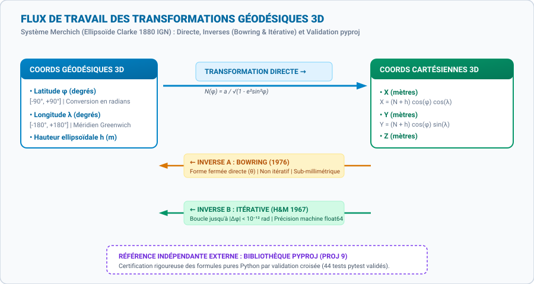
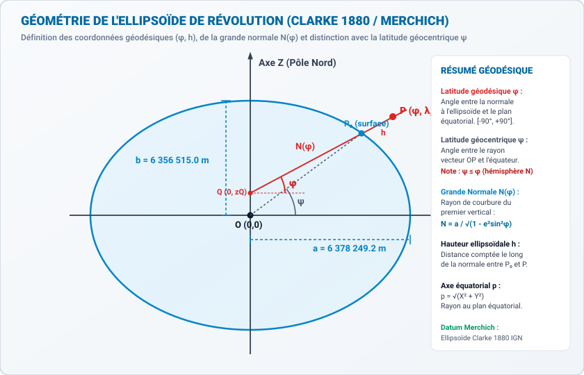
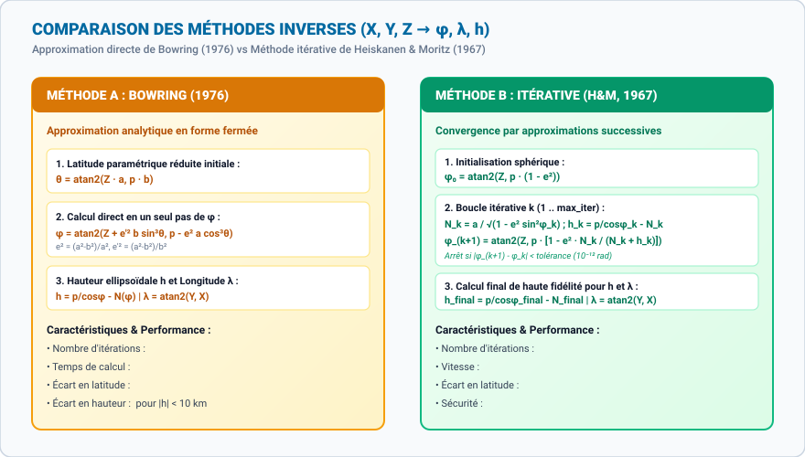
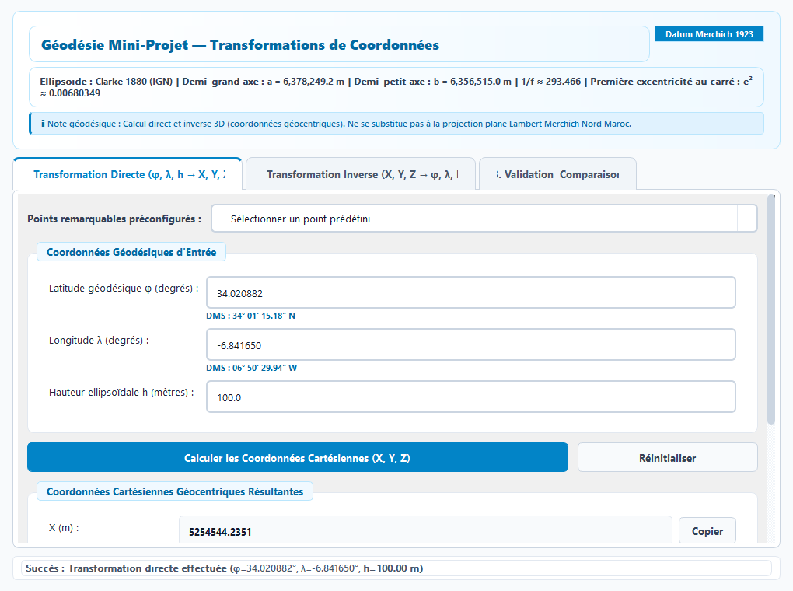
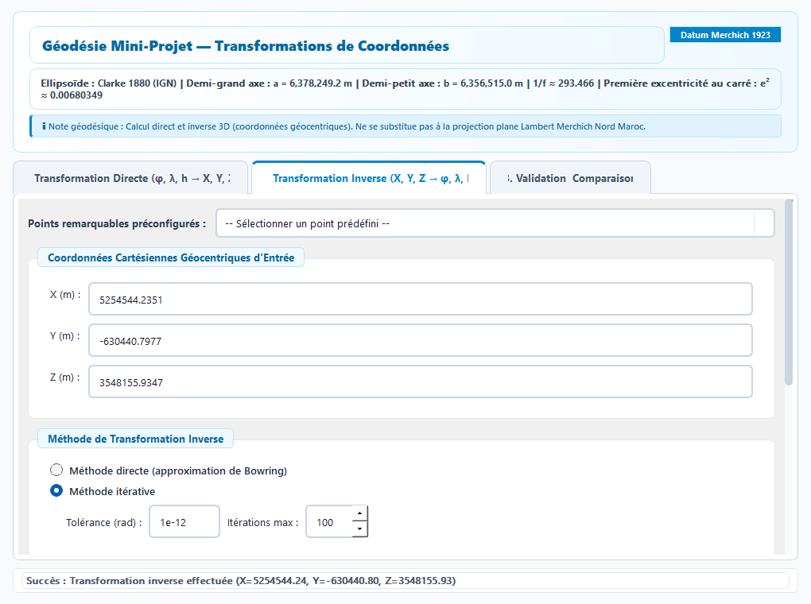
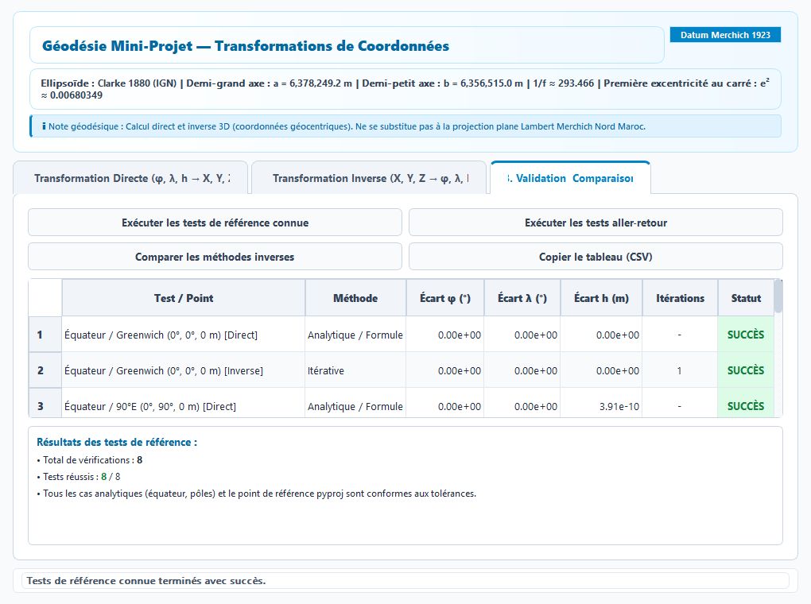

# Mini-Projet de Géodésie : Transformations de Coordonnées 3D (Système Merchich — Ellipsoïde Clarke 1880 IGN)

**Auteur :** Projet académique d'ingénierie géomatique et topographique  
**Cadre :** Travaux Pratiques et Mini-Projet de Géodésie Mathématique  
**Technologies :** Python 3, PyQt5, pytest, pyproj (référence de validation externe)

---

## Sommaire

1. [Titre du Projet et Vue d'Ensemble](#1-titre-du-projet-et-vue-densemble)
2. [Contexte et Objectifs](#2-contexte-et-objectifs)
3. [Fondements Mathématiques](#3-fondements-mathématiques)
4. [Paramètres de l'Ellipsoïde et du Référentiel](#4-paramètres-de-lellipsoïde-et-du-référentiel)
5. [Transformation Directe : $(\varphi, \lambda, h) \to (X, Y, Z)$](#5-transformation-directe)
6. [Transformation Inverse : Méthode de Bowring (1976)](#6-transformation-inverse--méthode-de-bowring-1976)
7. [Transformation Inverse : Méthode Itérative de Convergence](#7-transformation-inverse--méthode-itérative-de-convergence)
8. [Interface Graphique et Fonctionnalités Principales](#8-interface-graphique-et-fonctionnalités-principales)
9. [Architecture Logicielle et Organisation des Fichiers](#9-architecture-logicielle-et-organisation-des-fichiers)
10. [Installation et Exécution sous Windows](#10-installation-et-exécution-sous-windows)
11. [Méthodologie de Validation](#11-méthodologie-de-validation)
12. [Résultats des Tests et Analyse Numérique](#12-résultats-des-tests-et-analyse-numérique)
13. [Limites Connues et Perspectives d'Amélioration](#13-limites-connues-et-perspectives-damélioration)
14. [Références Bibliographiques et Remerciements](#14-références-bibliographiques-et-remerciements)

---

## 1. Titre du Projet et Vue d'Ensemble

Ce mini-projet met en œuvre une suite logicielle complète pour les transformations de coordonnées géodésiques et cartésiennes géocentriques tridimensionnelles (3D) relatives au système géodésique marocain **Merchich**, basé sur l'ellipsoïde de révolution de **Clarke 1880 (IGN)**.

L'application associe :
- Un noyau de calcul géodésique rigoureux en pur Python ([`transformations.py`](file:///d:/GEODESY%20PROJETCS/transformations.py)), sans dépendance obligatoire au moteur Proj pour l'exécution.
- Une interface graphique moderne et responsive développée en PyQt5 ([`main.py`](file:///d:/GEODESY%20PROJETCS/main.py)), offrant la conversion en degrés décimaux et DMS, l'affichage instantané, l'export et un tableau de bord de validation.
- Deux scripts d'automatisation Windows ([`run.bat`](file:///d:/GEODESY%20PROJETCS/run.bat) et [`test.bat`](file:///d:/GEODESY%20PROJETCS/test.bat)).
- Une suite complète de **44 tests unitaires automatisés** validés à 100% avec `pytest` ([`tests/test_transformations.py`](file:///d:/GEODESY%20PROJETCS/tests/test_transformations.py)).



---

## 2. Contexte et Objectifs

En géodésie spatiale et en topométrie moderne, les coordonnées d'un point physique peuvent être exprimées soit sous forme curviligne $(\varphi, \lambda, h)$ par rapport à un ellipsoïde de référence, soit sous forme cartésienne géocentrique orthonormée $(X, Y, Z)$.

Dans le cadre des réseaux géodésiques marocains (datum Merchich), le passage entre ces deux représentations est indispensable pour :
1. Intégrer des levés satellitaires GNSS (coordonnées cartésiennes tridimensionnelles) avec la géodésie classique ellipsoïdale.
2. Garantir une intégrité sub-millimétrique lors des allers-retours directs et inverses.
3. Comparer scientifiquement les performances d'une solution fermée rapide (Bowring) et d'une méthode de convergence exacte (Heiskanen & Moritz).
4. Offrir à l'utilisateur et à l'ingénieur topographe un outil ergonomique, pédagogique et directement utilisable sans configuration complexe.

---

## 3. Fondements Mathématiques

### 3.1. Géométrie de l'Ellipsoïde et Notations

Un ellipsoïde de révolution aplati est engendré par la rotation d'une ellipse méridienne autour de son petit axe (l'axe polaire de rotation terrestre).



### 3.2. Latitude Géodésique ($\varphi$) vs Latitude Géocentrique ($\psi$)
Une distinction théorique cruciale réside dans la différence entre ces deux latitudes :
- **La latitude géodésique $\varphi$** : Angle que fait la **normale** à l'ellipsoïde au point considéré avec le plan de l'équateur. C'est la latitude utilisée sur toutes les cartes, récepteurs GNSS et formulaires géodésiques.
- **La latitude géocentrique $\psi$** : Angle que fait le **rayon vecteur $OP$** reliant le centre de la Terre (géocentre) au point avec le plan équatorial.

La relation analytique entre les deux grandeurs est donnée par :
$$
\tan\psi = (1 - e^2)\tan\varphi = \frac{b^2}{a^2}\tan\varphi
$$
Dans l'hémisphère Nord ($0 < \varphi < 90^\circ$), puisque $e^2 > 0$, on a systématiquement $\psi < \varphi$. L'écart maximal $\varphi - \psi$ atteint environ $11{,}6$ minutes d'arc à $\varphi \approx 45^\circ$.

### 3.3. Rayon de Courbure de la Grande Normale $N(\varphi)$
Le rayon de courbure du premier vertical (ou grande normale) $N(\varphi)$ mesure la distance, comptée le long de la normale à l'ellipsoïde, entre la surface ellipsoïdale et l'axe de rotation polaire $Z$ :
$$
N(\varphi) = \frac{a}{\sqrt{1 - e^2 \sin^2\varphi}}
$$

---

## 4. Paramètres de l'Ellipsoïde et du Référentiel

Le datum Merchich (historiquement rattaché au point fondamental de Merchich près de Tit Mellil, Maroc) utilise l'ellipsoïde **Clarke 1880 (IGN)**. Les paramètres numériques rigoureusement implémentés dans [`transformations.py`](file:///d:/GEODESY%20PROJETCS/transformations.py) sont :

| Paramètre géométrique | Symbole | Valeur numérique officielle |
| :--- | :---: | :--- |
| **Demi-grand axe** | $a$ | $6\,378\,249{,}200\text{ m}$ |
| **Demi-petit axe** | $b$ | $6\,356\,515{,}000\text{ m}$ |
| **Aplatissement géométrique** | $f = (a - b)/a$ | $\approx 1 / 293{,}46602078$ |
| **Première excentricité au carré** | $e^2 = (a^2 - b^2)/a^2$ | $\approx 0{,}006803487648$ |
| **Deuxième excentricité au carré** | $e'^2 = (a^2 - b^2)/b^2$ | $\approx 0{,}006850085408$ |

> [!IMPORTANT]
> **Distinction essentielle :**  
> Ce projet traite exclusivement du passage tridimensionnel 3D entre $(\varphi, \lambda, h)$ et $(X, Y, Z)$ sur l'ellipsoïde Clarke 1880 IGN.  
> Il ne réalise **pas** de projection plane cartographique 2D (telle que la projection conique conforme de Lambert Merchich Nord Maroc, EPSG:26191) et n'applique **pas** de transformation de datum vers le système GPS mondial WGS 84 (EPSG:4326).

---

## 5. Transformation Directe : $(\varphi, \lambda, h) \to (X, Y, Z)$

Les équations de transformation directe projettent un point géodésique de latitude $\varphi$, longitude $\lambda$ et hauteur ellipsoïdale $h$ dans le repère cartésien géocentrique :

$$
\begin{cases}
X = (N(\varphi) + h) \cos\varphi \cos\lambda \\
Y = (N(\varphi) + h) \cos\varphi \sin\lambda \\
Z = [N(\varphi)(1 - e^2) + h] \sin\varphi
\end{cases}
$$

### Détails d'implémentation
1. **Conversion en radians** : Les angles en degrés décimaux sont convertis via `math.radians()` avant tout appel trigonométrique (`math.sin`, `math.cos`).
2. **Rayon géocentrique** : L'interface calcule également la distance géocentrique globale $R = \sqrt{X^2 + Y^2 + Z^2}$.

---

## 6. Transformation Inverse : Méthode de Bowring (1976)

La transformation inverse $(X, Y, Z) \to (\varphi, \lambda, h)$ est non linéaire car l'inconnue $\varphi$ figure sous le radical dans $N(\varphi)$.

B. R. Bowring a établi en 1976 une solution analytique directe en introduisant la latitude paramétrique réduite $\theta$ :

1. Distance équatoriale :
   $$
   p = \sqrt{X^2 + Y^2}
   $$
2. Latitude paramétrique initiale :
   $$
   \theta = \operatorname{atan2}(Z \cdot a,\, p \cdot b)
   $$
3. Formule fermée pour la latitude géodésique :
   $$
   \varphi = \operatorname{atan2}\left(Z + e'^2 \cdot b \cdot \sin^3\theta,\; p - e^2 \cdot a \cdot \cos^3\theta\right)
   $$
4. Hauteur ellipsoïdale et longitude :
   $$
   h = \frac{p}{\cos\varphi} - N(\varphi) \quad (\text{ou formulation polaire adaptée si } |\cos\varphi| \le 10^{-10})
   $$
   $$
   \lambda = \operatorname{atan2}(Y, X)
   $$

**Avantages :** Méthode non itérative, instantanée et déterministe en temps de calcul. L'erreur résiduelle est inférieure à $10^{-7\circ}$ (sub-millimétrique) pour toutes les altitudes terrestres.

---

## 7. Transformation Inverse : Méthode Itérative de Convergence

Issue des travaux de référence de Heiskanen & Moritz (1967), cette méthode affine successivement la latitude jusqu'à convergence numérique vers la précision machine :

1. **Initialisation** :
   $$
   \varphi_0 = \operatorname{atan2}(Z,\, p(1 - e^2))
   $$
2. **Itération $k$ ($k \ge 1$)** :
   $$
   N_k = \frac{a}{\sqrt{1 - e^2 \sin^2\varphi_k}}
   $$
   $$
   h_k = \frac{p}{\cos\varphi_k} - N_k
   $$
   $$
   \varphi_{k+1} = \operatorname{atan2}\left(Z,\, p\left[1 - e^2 \frac{N_k}{N_k + h_k}\right]\right)
   $$
3. **Condition d'arrêt** :
   $$
   |\varphi_{k+1} - \varphi_k| < 10^{-12}\text{ rad}
   $$



---

## 8. Interface Graphique et Fonctionnalités Principales

L'application intègre une interface graphique complète en **PyQt5** (thème clair soigné, réactif et entièrement ajustable) :

### 8.1. Onglet 1 : Transformation Directe
- Saisie interactive en degrés décimaux avec prévisualisation dynamique au format **DMS** (Degrés, Minutes, Secondes).
- Points géodésiques préconfigurés au Maroc (Rabat, Merchich, Marrakech, Tanger, Dépression Sebkha Tah) et points singuliers (Pôles, Équateur).
- Copie rapide des résultats et transfert en un clic vers l'onglet inverse.



### 8.2. Onglet 2 : Transformation Inverse
- Saisie de $(X, Y, Z)$ en mètres.
- Choix de la méthode inverse : **Bowring (directe)** ou **Itérative (convergence)**.
- Réglage de la tolérance angulaire (défaut : $10^{-12}\text{ rad}$) et du nombre maximal d'itérations.
- Affichage du nombre d'itérations réelles nécessaires à la convergence.



### 8.3. Onglet 3 : Tableau de Bord de Validation
- Exécution en un clic des séries de tests géodésiques.
- Affichage des écarts résiduels $(\Delta\varphi, \Delta\lambda, \Delta h)$ et du statut de succès.
- Export immédiat du tableau complet au format CSV vers le presse-papiers.



---

## 9. Architecture Logicielle et Organisation des Fichiers

Le projet adopte une séparation stricte entre logique algorithmique pure et interface graphique :

```text
GEODESY PROJETCS/
├── main.py                     # Interface graphique PyQt5 et contrôleurs
├── transformations.py          # Module de calcul géodésique pur (indépendant de l'IHM)
├── requirements.txt            # Liste des dépendances pip (PyQt5, pyproj, pytest)
├── pytest.ini                  # Configuration standard de découverte pytest
├── run.bat                     # Lanceur automatisé Windows pour l'application
├── test.bat                    # Lanceur automatisé Windows pour la suite de tests
├── README.md                   # Rapport technique et documentation du projet
├── docs/
│   ├── formules.md             # Document de référence des dérivations mathématiques
│   └── images/                 # Diagrammes vectoriels SVG et captures d'écran réelles
│       ├── ellipsoid_geometry.svg
│       ├── workflow_transformations.svg
│       ├── methods_comparison.svg
│       ├── screenshot_direct.png
│       ├── screenshot_inverse.png
│       └── screenshot_validation.png
└── tests/
    └── test_transformations.py # Suite de 44 tests unitaires et d'intégration
```

---

## 10. Installation et Exécution sous Windows

### 10.1. Prérequis
- **Windows 10 ou 11**
- **Python 3.10 ou supérieur** installé avec l'option indispensable cochée :  
  `[X] Add python.exe to PATH`

### 10.2. Lancement en un clic via les scripts `.bat`
- **Pour démarrer l'application :** Double-cliquez sur [`run.bat`](file:///d:/GEODESY%20PROJETCS/run.bat).  
  *Le script détecte Python, crée automatiquement l'environnement virtuel `.venv` s'il est absent, installe les dépendances requises et démarre l'interface graphique.*
- **Pour exécuter les tests :** Double-cliquez sur [`test.bat`](file:///d:/GEODESY%20PROJETCS/test.bat).  
  *Le script lance pytest et affiche un compte-rendu clair en français sans refermer la console.*

### 10.3. Lancement manuel en ligne de commande (PowerShell / CMD)
```powershell
# 1. Création et activation de l'environnement virtuel
python -m venv .venv
.\.venv\Scripts\Activate.ps1

# 2. Installation des dépendances
pip install -r requirements.txt

# 3. Lancement de l'IHM
python main.py

# 4. Exécution des tests automatisés
python -m pytest -v
```

---

## 11. Méthodologie de Validation

La validation de l'application repose sur quatre niveaux d'exigence complémentaires :

1. **Cas analytiques aux valeurs exactes** :
   - Équateur / Greenwich $(0^\circ, 0^\circ, 0\text{ m}) \implies (a, 0, 0)$.
   - Équateur / 90° Est $(0^\circ, 90^\circ, 0\text{ m}) \implies (0, a, 0)$.
   - Pôle Nord $(90^\circ, 0^\circ, 0\text{ m}) \implies (0, 0, b)$.
2. **Comparaison avec pyproj (Proj 9)** :
   - Validation croisée sur un point d'intérêt au Maroc (Rabat : $34{,}020882^\circ\text{ N}, -6{,}841650^\circ\text{ W}, 100\text{ m}$) avec les coordonnées calculées indépendamment par pyproj.
3. **Tests aller-retour (Round-trip)** :
   - Transformation directe $(\varphi, \lambda, h) \to (X, Y, Z)$ puis réinjection dans les deux méthodes inverses pour mesurer l'erreur de boucle fermée.
4. **Cas limites et robustesse numérique** :
   - Traitement des pôles ($p < 10^{-12}\text{ m}$), rejet du géocentre (`UndefinedCoordinateError`), gestion des hauteurs négatives (Sebkha Tah, $-50\text{ m}$), franchissement de l'antiméridien ($\pm 180^\circ$) et rejet des valeurs `NaN`/infinies.

---

## 12. Résultats des Tests et Analyse Numérique

### 12.1. Tests automatisés pytest
L'ensemble de la suite de tests a été exécuté via `pytest` :
```text
============================= test session starts =============================
platform win32 -- Python 3.15.0rc3, pytest-9.1.1, pluggy-1.6.0
rootdir: D:\GEODESY PROJETCS
configfile: pytest.ini
collected 44 items

tests/test_transformations.py ............................................ [100%]

============================= 44 passed in 0.58s ==============================
```
**Résultat :** **44 tests sur 44 validés avec succès (100%)**.

### 12.2. Résultats observés dans l'interface graphique (Dashboard Validation)
Les séries de tests intégrées à l'IHM affichent les résultats suivants :
- **Tests de référence connue :** **8 / 8 vérifications réussies** (écarts $\le 10^{-9}\text{ m}$).
- **Tests aller-retour (Direct $\leftrightarrow$ Inverse) :** **16 / 16 vérifications réussies** sur l'ensemble des sites marocains et mondiaux.
- **Comparaison Bowring vs Itérative :** **7 / 7 scénarios validés**.
  - Écart maximal en latitude : $\Delta\varphi \approx 2{,}47 \times 10^{-8\circ}$ ($\approx 0{,}003\text{ mm}$ sur l'ellipsoïde).
  - Écart maximal en hauteur : $\Delta h \approx 4{,}2 \times 10^{-4}\text{ m}$ ($\approx 0{,}42\text{ mm}$).
  - Nombre moyen d'itérations : **3 à 4 itérations** pour une tolérance de $10^{-12}\text{ rad}$.

---

## 13. Limites Connues et Perspectives d'Amélioration

### Limites actuelles
1. **Périmètre géodésique 3D strict** : Le projet ne met pas en œuvre les projections planes cartographiques 2D (projection Lambert Maroc zones I à IV).
2. **Absence de transformation de datum 7 paramètres** : Le passage direct entre Merchich et WGS 84 (GPS mondial) nécessite des paramètres de translation/rotation/échelle (Helmert) non implémentés ici.
3. **Singularité au centre de masse** : Le géocentre $(0, 0, 0)$ est mathématiquement indéfini et lève une exception interceptée.

### Perspectives d'amélioration
- Ajout d'un module de projection plane conique conforme de **Lambert Merchich (Nord Maroc, Sud Maroc)** avec calcul du facteur d'échelle et de la convergence des méridiens.
- Implémentation de la transformation de Helmert 7 paramètres (Merchich $\to$ WGS 84).
- Calcul de la distance géodésique le long de l'ellipsoïde par l'algorithme de Vincenty.
- Traitement par lot (batch processing) de fichiers de semis de points topographiques (CSV, TXT, DXF).

---

## 14. Références Bibliographiques et Remerciements

### Références bibliographiques officielles
1. **Bowring, B. R. (1976)**. *Transformation from spatial to geographical coordinates*. Survey Review, Vol. XXIII, n° 181, pp. 323–327.
2. **Heiskanen, W. A., & Moritz, H. (1967)**. *Physical Geodesy*. W. H. Freeman and Company, San Francisco.
3. **Hofmann-Wellenhof, B., Lichtenegger, H., & Collins, J. (2001)**. *GPS: Theory and Practice* (5th ed.). Springer-Verlag, Vienne.
4. **Institut Géographique National (IGN France)**. *Formules de transformations géodésiques et paramètres des ellipsoïdes de référence*.
5. **Agence Nationale de la Conservation Foncière, du Cadastre et de la Cartographie (ANCFCC, Maroc)**. *Documentation officielle sur le système géodésique Merchich et le réseau géodésique marocain*.

### Remerciements
Ce travail a été réalisé dans le cadre de notre formation en sciences géodésiques et topographiques. Nous tenons à remercier notre professeur pour ses enseignements précieux en géodésie géométrique et calculs de réseaux.
